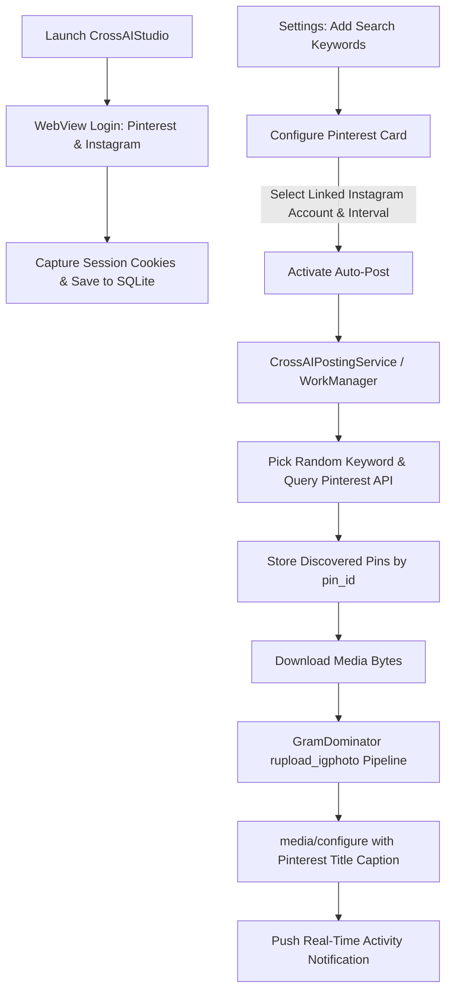

# 🚀 CrossAIStudio

<div align="center">


-blue?style=for-the-badge)
-lightgrey?style=for-the-badge)


**Automated Pinterest-to-Instagram Content Engine with GramDominator Integration & Persistent Background Services**

</div>

---

## 📖 Overview

**CrossAIStudio** is a native Android application designed to fully automate cross-platform social media syndication from **Pinterest** to **Instagram**. It enables creators, marketers, and social managers to link accounts via an integrated in-app WebView session capturer, harvest trending video/image pins using randomized keyword queries, and automatically schedule & publish them to Instagram with full metadata fidelity.

CrossAIStudio incorporates core upload routines derived from the enterprise **GramDominator** library, executes resiliently in the background even after being swiped from Recent Apps, and handles Android 15 edge-to-edge window insets flawlessly.

---

## ✨ Key Features

### 1. 🔐 Interactive WebView Session Capture
- **Pure Authentication Flow**: In-app secure WebView navigation directly to official Pinterest and Instagram login portals.
- **Anti-Guest Protection**: Specifically waits until the user finishes logging in with their own credentials before capturing session tokens.
- **Multi-Account Support**: Manage multiple Pinterest and Instagram accounts simultaneously with live status monitoring (`Active`, `Expired`, `Re-login Required`).

### 2. 🔍 Automated Keyword-Driven Pin Discovery
- **Configurable Keywords**: Add, manage, and delete custom search keywords in the Settings tab.
- **Deep Pagination & Deduplication**: Employs Pinterest's internal search resource payloads (`PinteresetSearch.txt` & `PinterestSearchWithPagination.txt`) with bookmark pagination to extract high-resolution video and photo pins.
- **SQLite Pin Vault**: Discovered pins are uniquely keyed by `pin_id` to prevent redundant downloads or duplicate reposts.

### 3. 📸 GramDominator-Powered Instagram Publishing
- **Enterprise Upload Architecture**: Integrated with GramDominator's `rupload_igphoto` chunked upload protocol and `media/configure` pipeline.
- **Intelligent Caption Engine**: Uses original Pinterest pin titles as the Instagram post caption, intelligently falling back to the originating search keyword.
- **High-Resolution Media Processing**: Downloads original media bytes, handles image dimensions, and dispatches directly to Instagram's mobile REST endpoints with simulated device user-agents.

### 4. ⚙️ Resilient Background Automation Engine
- **Swipe-Proof Foreground Service (`CrossAIPostingService`)**: Continues execution even when closed or swiped away from Android's Recent Tasks list using `onTaskRemoved` auto-restart alarms.
- **Device Reboot Resurrection (`BootReceiver`)**: Automatically re-registers scheduled tasks upon system startup (`BOOT_COMPLETED`, `MY_PACKAGE_REPLACED`).
- **OEM Battery Optimization Handling**: Prompts for battery optimization bypass (`ACTION_REQUEST_IGNORE_BATTERY_OPTIMIZATIONS`) to prevent background killing on aggressive OEM ROMs.
- **Flexible Scheduling**: Set independent hourly or daily intervals per Pinterest account (e.g., Every 1h, 2h, 6h, 12h, 24h).

### 5. 🔔 Real-Time Activity Notification Dispatcher
Pushes rich, high-priority notifications for all background actions:
- 🔍 **Search Dispatched**: Notifies when searching Pinterest with a chosen keyword.
- 📥 **Pins Ingested**: Alerts how many new pins were extracted and saved.
- 🚀 **Instagram Upload**: Tracks media upload progress.
- 🎉 **Publish Success**: Confirms successful Instagram posting with preview caption.
- ⚠️ **Session Alerts**: Warns immediately if an account cookie expires.

### 6. 🎨 Material 3 Edge-to-Edge Design
- Custom status bar and display cutout / camera punch-hole insets handling (`ViewCompat.setOnApplyWindowInsetsListener`).
- Seamless dark-mode surface palette (`#181B22` headers, `#0F1115` canvas).
- Custom neon cyber-cross launcher branding across all mipmap densities.

---

## 🛠️ Architecture & Tech Stack

```
d:\PinToInsta
├── app/
│   ├── src/main/
│   │   ├── java/com/pintoinsta/app/
│   │   │   ├── data/
│   │   │   │   ├── db/            # SQLite OpenHelper (AppDatabaseHelper)
│   │   │   │   ├── model/         # Account, Pin, Log data classes
│   │   │   │   └── repository/    # AppRepository (Data abstraction layer)
│   │   │   ├── network/
│   │   │   │   ├── PinterestClient.kt  # Pinterest search & session validator
│   │   │   │   └── InstagramClient.kt  # GramDominator Instagram upload pipeline
│   │   │   ├── notification/      # NotificationHelper (Notification channels)
│   │   │   ├── receiver/          # BootReceiver & RestartServiceReceiver
│   │   │   ├── service/           # CrossAIPostingService (Foreground worker)
│   │   │   ├── ui/
│   │   │   │   ├── instagram/     # Instagram Fragment & Card Adapter
│   │   │   │   ├── pins/          # Saved Pins & Activity Logs Fragment
│   │   │   │   ├── pinterest/     # Pinterest Fragment, Linking & Scheduler
│   │   │   │   ├── settings/      # Keyword Manager
│   │   │   │   └── webview/       # WebLoginActivity (Cookie capture engine)
│   │   │   ├── worker/            # WorkManager scheduled job workers
│   │   │   ├── MainActivity.kt
│   │   │   └── PinToInstaApp.kt
│   │   └── res/                   # Layouts, drawables, mipmaps, colors, themes
│   └── build.gradle
├── signing/                       # Release keystore & public certificate
├── CrossAIStudio-release.apk      # Pre-compiled, signed production release APK
├── build.gradle
├── gradle.properties
├── settings.gradle
└── README.md
```

### Libraries & Dependencies
| Component | Library | Version | Purpose |
| :--- | :--- | :--- | :--- |
| **Language** | Kotlin Android | `1.9.24` | Primary codebase |
| **Networking** | OkHttp3 | `4.12.0` | API requests & media uploads |
| **Image Loading** | Coil | `2.6.0` | Asynchronous image caching |
| **Scheduler** | AndroidX WorkManager | `2.9.1` | Scheduled periodic background sync |
| **UI Components** | Google Material 3 | `1.12.0` | BottomNavigationView, cards, insets |
| **Coroutines** | Kotlinx Coroutines | `1.9.0` | Background asynchronous operations |

---

## 📲 Installation & Quick Start

### Option A: Install Pre-Built Release APK (Fastest)
Download and install [`CrossAIStudio-release.apk`](CrossAIStudio-release.apk) directly via ADB:
```powershell
adb install -r CrossAIStudio-release.apk
```

### Option B: Build from Source

1. **Clone the Repository**:
   ```bash
   git clone https://github.com/rahmatullah-21/CrossAIStudio.git
   cd CrossAIStudio
   ```

2. **Verify Java 17 Requirement**:
   ```bash
   java -version
   ```

3. **Build Debug APK**:
   ```powershell
   .\gradlew.bat assembleDebug
   ```

4. **Build Signed Release APK**:
   ```powershell
   .\gradlew.bat assembleRelease
   ```
   *The signed APK will be output to: `app/build/outputs/apk/release/app-release.apk`*

---

## 🔐 Release Signing Configuration

The release APK is signed with a valid v2 Android release keystore:
- **Keystore**: `crossaistudio-release.jks`
- **Key Alias**: `crossaistudio`
- **Signature Scheme**: APK Signature Scheme v2 (Full integrity verified)
- **Certificate**: Exported X.509 certificate available at [`signing/crossaistudio-certificate.cer`](signing/crossaistudio-certificate.cer)

---

## 🔄 Workflow Diagram



---

## 🛡️ License

This project is licensed under the MIT License - see the repository LICENSE for details.
All rights reserved © 2026 CrossAIStudio.
